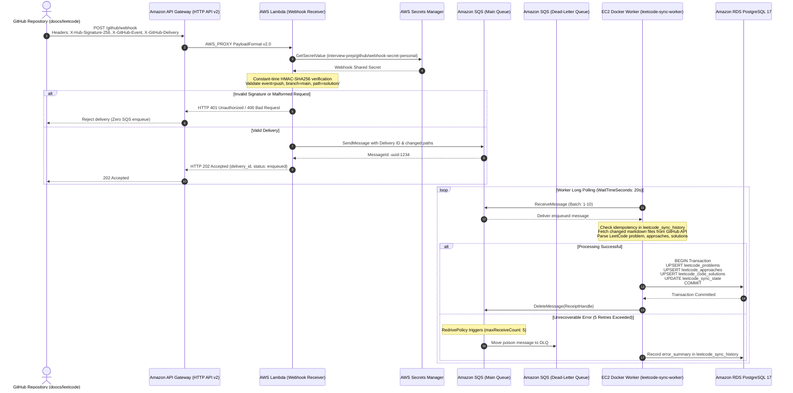

# LeetCode Synchronization Pipeline Implementation Plan

**Target System:** `interview-prep` LeetCode Webhook-to-RDS Processing Pipeline  
**Target AWS Account:** `808431466075` | **Region:** `ap-south-2` (Hyderabad)  
**IaC Template:** `interview-app/infrastructure/cloudformation/leetcode-sync-pipeline.yaml`  
**Execution Lead:** Principal Cloud Architect & Integration Lead  

---

## 1. Logical Architecture & Request/Message Flow



---

## 2. Step-by-Step Execution Sequence

### Stage 1: Security & Secrets Setup
1. Generate a secure, 32-byte cryptographic random hex token for GitHub webhook signing.
2. Create AWS Secrets Manager secret:
   ```bash
   aws secretsmanager create-secret \
     --name "interview-prep/github/webhook-secret-personal" \
     --description "GitHub HMAC-SHA256 webhook signing secret for LeetCode sync pipeline" \
     --secret-string '{"webhook_secret":"<GENERATED_HEX_KEY>"}' \
     --region ap-south-2
   ```
3. Record `WebhookSecretArn`.

### Stage 2: Lambda Deployment Package Preparation & S3 Ingestion
1. Compress `interview-app/infrastructure/lambda/github_webhook_receiver/handler.py` and `__init__.py` into `github-webhook-receiver.zip`.
2. Upload the zip package to the personal assets bucket:
   ```bash
   aws s3 cp github-webhook-receiver.zip s3://interview-prep-assets-808431466075-personal-ap-south-2/lambda/github-webhook-receiver.zip --region ap-south-2
   ```
3. Verify object presence and MD5/SHA256 checksum on S3.

### Stage 3: IaC CloudFormation Stack Deployment
1. Reconcile manually created SQS queues (delete the empty queues created during earlier testing so CloudFormation creates and owns them cleanly without resource name collision).
2. Deploy `interview-app/infrastructure/cloudformation/leetcode-sync-pipeline.yaml`:
   ```bash
   aws cloudformation create-stack \
     --stack-name interview-prep-leetcode-sync-personal \
     --template-body file://interview-app/infrastructure/cloudformation/leetcode-sync-pipeline.yaml \
     --parameters \
         ParameterKey=Environment,ParameterValue=personal \
         ParameterKey=EC2RoleName,ParameterValue=InterviewPrepEC2Role \
         ParameterKey=AttachPolicyToRole,ParameterValue=true \
         ParameterKey=SourceRepo,ParameterValue=doocs/leetcode \
         ParameterKey=SourceBranch,ParameterValue=main \
         ParameterKey=QuestionsPath,ParameterValue=solution/ \
         ParameterKey=WebhookSecretArn,ParameterValue="${WEBHOOK_SECRET_ARN}" \
     --capabilities CAPABILITY_NAMED_IAM \
     --region ap-south-2
   ```
3. Await `CREATE_COMPLETE` and capture outputs:
   - `ApiEndpoint` (URL: `https://<api-id>.execute-api.ap-south-2.amazonaws.com`)
   - `SqsQueueUrl`
   - `SqsQueueArn`
   - `SqsDlqArn`
   - `WebhookReceiverFunctionArn`

### Stage 4: Database Metadata Migration (`004_leetcode_sync_metadata.sql`)
1. Connect to RDS `interview_prep_db` through the backend container.
2. Execute `interview-app/migrations/rds/004_leetcode_sync_metadata.sql`:
   - Creates `public.leetcode_sync_state`
   - Creates `public.leetcode_sync_history`
   - Creates indexes on `commit_sha`, `created_at`, `source_repo, source_branch`
   - Sets update trigger `trg_leetcode_sync_state_updated_at`
3. Verify table presence in RDS `information_schema.tables`.

### Stage 5: Worker Hardening & Container Deployment
1. Update `interview-app/docker-compose.yml` to fail closed in production if `LEETCODE_SYNC_QUEUE_URL` is unset when `ENVIRONMENT=production`.
2. Update `/home/ubuntu/interview-prep/interview-app/.env` on the EC2 host:
   - Set `LEETCODE_SYNC_QUEUE_URL=<STACK_SQS_QUEUE_URL>`
   - Set `LEETCODE_SOURCE_REPO=doocs/leetcode`
   - Set `LEETCODE_SOURCE_BRANCH=main`
   - Set `LEETCODE_QUESTIONS_PATH=solution`
3. Start the `interview-prep-leetcode-sync-worker` container via Docker Compose:
   ```bash
   docker compose up -d --no-deps leetcode-sync-worker
   ```
4. Verify container status is `Up` and logs show successful initialization and long-polling connection to SQS.

### Stage 6: Operational Alerting Setup (Amazon SNS)
1. Create SNS Topic `interview-prep-alerts-personal` in `ap-south-2`.
2. Update CloudWatch metric alarms:
   - `interview-prep-ec2-high-cpu` -> AlarmAction: SNS Topic ARN
   - `interview-prep-ec2-status-check-failed` -> AlarmAction: SNS Topic ARN
   - `interview-prep-sqs-dlq-messages-visible` -> AlarmAction: SNS Topic ARN
   - Enable `ActionsEnabled: true`.

---

## 3. End-to-End Verification Matrix (Acceptance Criteria)

| Test ID | Test Scenario | Expected Outcome | Verification Tool / Command |
|---|---|---|---|
| **T1** | Valid Webhook Signature | API Gateway returns `202 Accepted`, message enqueued in SQS | Python HTTP test script with HMAC-SHA256 signature |
| **T2** | Invalid Webhook Signature | API Gateway returns `401 Unauthorized`, zero messages in SQS | Python HTTP test script with tampered signature |
| **T3** | Missing Signature Header | API Gateway returns `401 Unauthorized` | Python HTTP test script without `X-Hub-Signature-256` |
| **T4** | GitHub Ping Event | API Gateway returns `200 OK {"message": "pong"}` | Test payload with `X-GitHub-Event: ping` |
| **T5** | Non-Solution Push Event | API Gateway returns `200 OK {"message": "no questions affected"}` | Test push payload modifying `README.md` |
| **T6** | Worker SQS Consumption | Worker polls queue, receives message, logs delivery ID | Inspect worker container stdout logs |
| **T7** | Transactional Upsert | Problem records upserted into `leetcode_problems` with `updated_at` | Query RDS via backend container |
| **T8** | Duplicate Delivery | Second identical delivery acknowledged and skipped without duplicate row creation | Re-send identical `delivery_id` |
| **T9** | User Progress Preservation | Existing user bookmarks, progress, comments remain 100% untouched | Query `user_progress` before and after sync |
| **T10** | DLQ Redrive Behavior | Poison message retried 5 times then moved to DLQ | Enqueue malformed JSON directly to SQS |
| **T11** | CloudWatch DLQ Alarm | Alarm triggers when DLQ depth >= 1 | Check alarm state in CloudWatch API |
