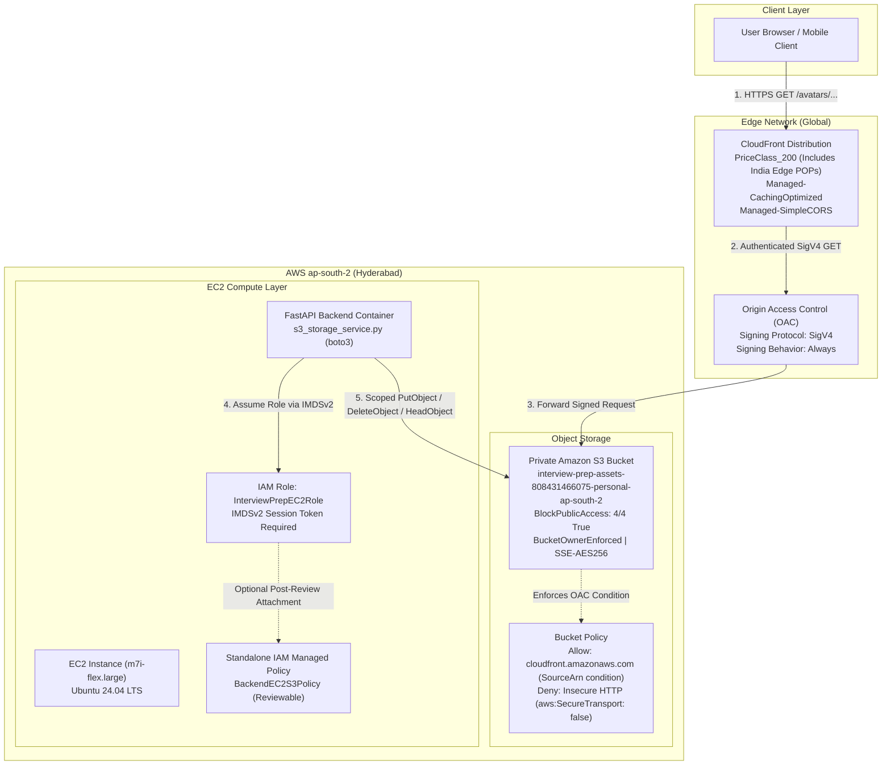

# AWS Infrastructure and IAM Specification: Cloudinary to S3 + CloudFront Migration

## 1. Executive Summary & Architecture

This document defines the production and staging infrastructure, IAM security policies, deployment runbooks, validation gates, cost projections, and safe rollback procedures for migrating the Interview Prep asset delivery pipeline from Cloudinary to Amazon Simple Storage Service (Amazon S3) and Amazon CloudFront.

### Architecture Overview



### Key Design Principles

1. **Zero Public S3 Access**: The S3 bucket is completely private. Direct internet access is blocked via S3 Block Public Access (all 4 flags active). No object ACLs are permitted (`BucketOwnerEnforced`), and legacy canned ACLs (`AccessControl: Private`) are eliminated to avoid configuration conflicts.
2. **Modern CloudFront Origin Access Control (OAC)**: Replaces legacy Origin Access Identity (OAI). OAC uses AWS Signature Version 4 (SigV4) with `always` signing behavior to authenticate CloudFront requests to S3, fully supporting SSE-KMS, regional endpoints like `ap-south-2`, and AWS partition compliance.
3. **Regional Endpoint Precision**: CloudFront is configured with the regional bucket endpoint (`${BucketName}.s3.ap-south-2.amazonaws.com`) rather than the global S3 endpoint (`${BucketName}.s3.amazonaws.com`), eliminating HTTP 307 temporary redirects that break SigV4 signed requests.
4. **Least-Privilege EC2 Runtime & Independent IAM Policy Review**: The backend FastAPI application runs on EC2 using instance metadata service v2 (IMDSv2) and inherits the existing `InterviewPrepEC2Role`. IAM permissions are provisioned as an isolated, standalone managed policy (`BackendEC2S3Policy`) that can be audited before attaching to any role. `AttachPolicyToRole` defaults to `false` in staging to guarantee that the live EC2 role is never mutated automatically.
5. **Separation of Runtime and Migration Permissions**: Runtime application permissions (`s3:PutObject`, `s3:GetObject`, `s3:DeleteObject`) are strictly scoped under the `avatars/*` prefix, preventing the application from modifying or deleting lesson media. One-time bulk migration write access (`s3:PutObject`) is separated into a distinct statement that can be audited and deprecated post-cutover.
6. **Infrastructure as Code (IaC)**: The entire deployment is captured in a declarative, idempotent AWS CloudFormation template located at `infrastructure/cloudformation/assets-s3-cloudfront.yaml`.

---

## 2. Target Environment & Resource Identifiers

| Parameter | Value | Description |
|---|---|---|
| **AWS Account ID** | `808431466075` | Target AWS account |
| **AWS Region** | `ap-south-2` | Hyderabad, India (co-located with EC2 workload) |
| **Bucket Naming Schema** | `interview-prep-assets-${AWS::AccountId}-${Environment}-${AWS::Region}` | Predictable, collision-free naming pattern |
| **Personal S3 Bucket Name** | `interview-prep-assets-808431466075-personal-ap-south-2` | Globally unique S3 bucket for personal environment |
| **Production S3 Bucket Name** | `interview-prep-assets-808431466075-production-ap-south-2` | Globally unique S3 bucket for production environment |
| **Existing EC2 IAM Role** | `InterviewPrepEC2Role` | Host role attached to EC2 instance profile (not mutated automatically) |
| **IAM Managed Policy** | `${AWS::StackName}-BackendEC2S3Policy` | Standalone IAM managed policy for review and attachment |
| **CloudFront Price Class** | `PriceClass_200` | Covers North America, Europe, Asia, Middle East, Africa (includes Indian Edge locations) |
| **CloudFront Cache Policy** | `658327ea-f89d-4fab-a63d-7e88639e58f6` | Managed-CachingOptimized |
| **CloudFront Response Headers** | `60669652-455b-4ae9-85a4-c4c02393f86c` | Managed-SimpleCORS |

### Object Key Namespace Schema

All assets uploaded to the S3 bucket follow the structured namespace contract:

* **User Profile Avatars**: `avatars/{user_id}/{unique_uuid}.{ext}`
* **System Design Diagrams & Lessons**: `system-design/{chapter_number}/{filename_slug}.{ext}`
* **Static Application Media**: `static/{category}/{filename_slug}.{ext}`

---

## 3. CloudFormation Template Architecture

The CloudFormation template is located at:
`infrastructure/cloudformation/assets-s3-cloudfront.yaml`

### Template Parameters

* **`Environment`**: Defaults to `staging` (AllowedValues: `staging`, `production`). Eliminates hardcoded production defaults.
* **`BucketName`**: Defaults to `''` (empty string). When left empty, dynamically evaluates to `interview-prep-assets-${AWS::AccountId}-${Environment}-${AWS::Region}`.
* **`EC2RoleName`**: Defaults to `InterviewPrepEC2Role`.
* **`AttachPolicyToRole`**: Defaults to `'false'` (AllowedValues: `'true'`, `'false'`). In staging, guarantees that the existing EC2 role is not modified during stack provisioning.
* **`PriceClass`**: Defaults to `PriceClass_200` (AllowedValues: `PriceClass_100`, `PriceClass_200`, `PriceClass_All`).
* **`ResponseHeadersPolicyId`**: Defaults to `60669652-455b-4ae9-85a4-c4c02393f86c` (`Managed-SimpleCORS`).

### Template Resource Matrix

#### 1. S3 Storage Bucket (`AssetsBucket`)
* **BucketName**: Dynamic name generated via `!Sub "interview-prep-assets-${AWS::AccountId}-${Environment}-${AWS::Region}"` unless explicitly overridden.
* **PublicAccessBlockConfiguration**:
  * `BlockPublicAcls: true`
  * `IgnorePublicAcls: true`
  * `BlockPublicPolicy: true`
  * `RestrictPublicBuckets: true`
* **OwnershipControls**: `BucketOwnerEnforced` (disables all S3 ACLs; the AWS account owning the bucket owns all objects).
* **Legacy ACL Removal**: No conflicting canned `AccessControl` properties are defined.
* **BucketEncryption**: Server-side encryption with AWS managed keys (`AES256`) and `BucketKeyEnabled: true` (reduces encryption overhead).
* **CorsConfiguration**: Allows `GET` and `HEAD` from `*` to ensure cross-origin avatar and diagram loading from browser frontends.
* **LifecycleConfiguration**: `AbortIncompleteMultipartUploads` enabled after 7 days to eliminate orphaned multipart storage costs.

#### 2. CloudFront Origin Access Control (`AssetsOriginAccessControl`)
* **Name**: `${AWS::StackName}-s3-oac`
* **OriginAccessControlOriginType**: `s3`
* **SigningBehavior**: `always`
* **SigningProtocol**: `sigv4`

#### 3. CloudFront Distribution (`AssetsDistribution`)
* **Origin**:
  * `DomainName`: `!GetAtt AssetsBucket.RegionalDomainName`
  * `OriginAccessControlId`: `!GetAtt AssetsOriginAccessControl.Id`
  * `S3OriginConfig: { OriginAccessIdentity: "" }`
* **DefaultCacheBehavior**:
  * `ViewerProtocolPolicy`: `redirect-to-https`
  * `AllowedMethods`: `[GET, HEAD]`
  * `CachedMethods`: `[GET, HEAD]`
  * `Compress`: `true` (enables Gzip and Brotli compression at edge)
  * `CachePolicyId`: `658327ea-f89d-4fab-a63d-7e88639e58f6` (`Managed-CachingOptimized`)
  * `ResponseHeadersPolicyId`: `60669652-455b-4ae9-85a4-c4c02393f86c` (`Managed-SimpleCORS`)
* **ViewerCertificate**: `CloudFrontDefaultCertificate: true` (AWS-managed wildcard certificate on `*.cloudfront.net`).
* **PriceClass**: `PriceClass_200` (can be overridden to `PriceClass_All` or `PriceClass_100`).

#### 4. S3 Bucket Policy (`AssetsBucketPolicy`)
Enforces two mandatory security statements:
1. `AllowCloudFrontServicePrincipalReadOnly`: Grants `s3:GetObject` strictly to principal `cloudfront.amazonaws.com` conditioned on `AWS:SourceArn` matching the specific CloudFront distribution ARN. This protects against the confused deputy vulnerability.
2. `EnforceTlsRequestsOnly`: Explicit `Deny` on `s3:*` when `aws:SecureTransport` is `false`, ensuring that all communications to S3 use TLS 1.2+.

#### 5. IAM Managed Policy (`BackendEC2S3Policy` - Runtime)
Created as a standalone `AWS::IAM::ManagedPolicy` with name `${AWS::StackName}-BackendEC2S3Policy`:
* Statement 1 (`RuntimeAvatarObjectAccess`): Grants `s3:PutObject`, `s3:GetObject`, and `s3:DeleteObject` scoped strictly under `avatars/*`.
* Statement 2 (`ScopedS3BucketListAccess`): Grants `s3:ListBucket` on the bucket root for object existence and 404 detection.
* `Roles` Property: Conditional via `!If [ShouldAttachPolicyToRole, [!Ref EC2RoleName], !Ref "AWS::NoValue"]`. Created unattached so engineers can review the policy independently.

#### 6. IAM Managed Policy (`AssetMigrationS3Policy` - One-Time Migration)
Created as a standalone `AWS::IAM::ManagedPolicy` with name `${AWS::StackName}-AssetMigrationS3Policy`:
* Statement 1 (`MigrationScopedObjectAccess`): Grants `s3:GetObject` and `s3:PutObject` scoped strictly to `avatars/*`, `system-design/*`, and `static/*`.
* Statement 2 (`MigrationScopedListAccess`): Grants `s3:ListBucket` on the bucket root.
* Security Rule: Zero `s3:DeleteObject` permissions granted to the migration policy.

### Template Outputs

* `BucketName`: Physical name of the S3 bucket (`interview-prep-assets-${AWS::AccountId}-${Environment}-${AWS::Region}`).
* `BucketArn`: ARN of the S3 bucket (`arn:aws:s3:::interview-prep-assets-...`).
* `CloudFrontDistributionId`: CloudFront distribution ID (used for cache invalidations).
* `CloudFrontDomainName`: CloudFront FQDN (e.g., `d111111abcdef8.cloudfront.net`).
* `AssetBaseUrl`: HTTPS base delivery URL (`https://${CloudFrontDomainName}`).
* `BackendEC2S3PolicyArn`: Amazon Resource Name of the standalone IAM managed policy for runtime backend.
* `AssetMigrationPolicyArn`: Amazon Resource Name of the standalone IAM managed policy for asset migration.

---

## 4. EC2 Least-Privilege IAM Policy Specification & Review Guide

### Standalone IAM Managed Policy Structure

The runtime managed policy (`BackendEC2S3Policy`) created by the CloudFormation stack contains two distinct, least-privilege statements:

```json
{
  "Version": "2012-10-17",
  "Statement": [
    {
      "Sid": "RuntimeAvatarObjectAccess",
      "Effect": "Allow",
      "Action": [
        "s3:PutObject",
        "s3:GetObject",
        "s3:DeleteObject"
      ],
      "Resource": "arn:aws:s3:::interview-prep-assets-808431466075-personal-ap-south-2/avatars/*"
    },
    {
      "Sid": "ScopedS3BucketListAccess",
      "Effect": "Allow",
      "Action": [
        "s3:ListBucket"
      ],
      "Resource": "arn:aws:s3:::interview-prep-assets-808431466075-personal-ap-south-2"
    }
  ]
}
```

The dedicated migration managed policy (`AssetMigrationS3Policy`) provides scoped read/write access without deletion:

```json
{
  "Version": "2012-10-17",
  "Statement": [
    {
      "Sid": "MigrationScopedObjectAccess",
      "Effect": "Allow",
      "Action": [
        "s3:GetObject",
        "s3:PutObject"
      ],
      "Resource": [
        "arn:aws:s3:::interview-prep-assets-808431466075-personal-ap-south-2/avatars/*",
        "arn:aws:s3:::interview-prep-assets-808431466075-personal-ap-south-2/system-design/*",
        "arn:aws:s3:::interview-prep-assets-808431466075-personal-ap-south-2/static/*"
      ]
    },
    {
      "Sid": "MigrationScopedListAccess",
      "Effect": "Allow",
      "Action": [
        "s3:ListBucket"
      ],
      "Resource": "arn:aws:s3:::interview-prep-assets-808431466075-personal-ap-south-2"
    }
  ]
}
```

### Technical Note on `HeadObject` and IAM Permissions

> [!NOTE]
> In Amazon S3, **`s3:HeadObject` is an API operation, NOT an IAM action**.
> 
> * AWS IAM maps the `HeadObject` API call directly to the **`s3:GetObject`** permission. Specifying `"Action": ["s3:HeadObject"]` in an IAM policy is invalid and will trigger an `Unrecognized action` warning or policy validation error.
> * Granting `s3:GetObject` on `.../avatars/*` fully authorizes boto3's `s3_client.head_object(Bucket=..., Key=...)` method for profile pictures.
> * Additionally, **`s3:ListBucket`** is included on the bucket root resource. When a requested object does NOT exist in S3:
>   * With `s3:ListBucket`: S3 returns a standard `404 Not Found` error.
>   * Without `s3:ListBucket`: S3 returns an ambiguous `403 Forbidden` error to prevent leaking key existence. Providing `s3:ListBucket` allows application code to reliably detect missing objects.

---

### Step-by-Step Policy Review Runbook (Before Attaching to Role)

Because `AttachPolicyToRole` defaults to `false`, the managed policy is provisioned in AWS IAM but is **NOT** attached to `InterviewPrepEC2Role`. Follow these steps to review the policy before attaching:

#### Step 1: Retrieve Policy ARN from Stack Outputs

```bash
export BACKEND_POLICY_ARN=$(aws cloudformation describe-stacks \
  --stack-name interview-prep-assets-personal \
  --region ap-south-2 \
  --query "Stacks[0].Outputs[?OutputKey=='BackendEC2S3PolicyArn'].OutputValue" \
  --output text)

echo "Standalone Policy ARN: $BACKEND_POLICY_ARN"
```

#### Step 2: Retrieve the Active Policy Version ID

```bash
aws iam get-policy \
  --policy-arn "$BACKEND_POLICY_ARN" \
  --query "Policy.[PolicyName, Arn, DefaultVersionId, AttachmentCount]" \
  --output table
```

*Expected output: `AttachmentCount` is `0`, confirming that no roles or users are bound to the policy yet.*

#### Step 3: Inspect the Policy Document

```bash
aws iam get-policy-version \
  --policy-arn "$BACKEND_POLICY_ARN" \
  --version-id v1 \
  --query "PolicyVersion.Document" \
  --output json
```

Verify the following security checkpoints during review:
1. `RuntimeAvatarObjectAccess` allows `PutObject`, `GetObject`, `DeleteObject` strictly under `/avatars/*`.
2. `OneTimeMigrationObjectAccess` allows `PutObject` only (no delete or get access on non-avatar objects).
3. `ScopedS3BucketListAccess` is limited strictly to the staging bucket ARN.
4. No wildcard access (`*`) to unauthorized buckets or AWS services exists.

#### Step 4: Manually Attach the Policy to `InterviewPrepEC2Role` (Only After Approval)

Once reviewed and approved:

```bash
aws iam attach-role-policy \
  --role-name InterviewPrepEC2Role \
  --policy-arn "$BACKEND_POLICY_ARN"
```

#### Step 5: Verify Role Attachment

```bash
aws iam list-attached-role-policies \
  --role-name InterviewPrepEC2Role \
  --query "AttachedPolicies[?PolicyArn=='$BACKEND_POLICY_ARN']" \
  --output table
```

#### Step 6: Detach Policy If Needed (Immediate Non-Destructive Revocation)

If access needs to be removed at any point without destroying resources:

```bash
aws iam detach-role-policy \
  --role-name InterviewPrepEC2Role \
  --policy-arn "$BACKEND_POLICY_ARN"
```

---

## 5. Deployment Guide

### Prerequisites

1. AWS CLI v2 installed and configured.
2. Active credentials for AWS Account `808431466075` with permissions for CloudFormation, S3, CloudFront, and IAM.
3. Target deployment region set to `ap-south-2`.

```bash
export AWS_DEFAULT_REGION="ap-south-2"
export AWS_REGION="ap-south-2"
```

### Step 1: Validate CloudFormation Template

Perform static syntax and structural validation:

```bash
aws cloudformation validate-template \
  --template-body file://infrastructure/cloudformation/assets-s3-cloudfront.yaml \
  --region ap-south-2
```

### Step 2: Create and Review Change Set for Personal Stack

Before applying changes, generate an inspection change set:

```bash
aws cloudformation create-change-set \
  --stack-name interview-prep-assets-personal \
  --change-set-name personal-initial-setup \
  --template-body file://infrastructure/cloudformation/assets-s3-cloudfront.yaml \
  --parameters \
      ParameterKey=Environment,ParameterValue=personal \
      ParameterKey=AttachPolicyToRole,ParameterValue=false \
      ParameterKey=PriceClass,ParameterValue=PriceClass_200 \
  --capabilities CAPABILITY_NAMED_IAM \
  --region ap-south-2
```

Inspect the pending changes:

```bash
aws cloudformation describe-change-set \
  --stack-name interview-prep-assets-personal \
  --change-set-name personal-initial-setup \
  --region ap-south-2
```

### Step 3: Deploy CloudFormation Stack

#### Staging Deployment (Default):
Deploy the personal stack with explicit stack name `interview-prep-assets-personal`:

```bash
aws cloudformation deploy \
  --template-file infrastructure/cloudformation/assets-s3-cloudfront.yaml \
  --stack-name interview-prep-assets-personal \
  --parameter-overrides \
      Environment=personal \
      AttachPolicyToRole=false \
      PriceClass=PriceClass_200 \
  --capabilities CAPABILITY_NAMED_IAM \
  --region ap-south-2 \
  --no-fail-on-empty-changeset
```

> [!NOTE]
> In staging, `AttachPolicyToRole` defaults to `false` so `InterviewPrepEC2Role` is never mutated automatically.
> CloudFront distribution creation typically takes between 3 to 5 minutes to globally propagate edge configurations.

#### Production Deployment (When Ready for Cutover):
Deploy the production stack with explicit stack name `interview-prep-assets-production`:

```bash
aws cloudformation deploy \
  --template-file infrastructure/cloudformation/assets-s3-cloudfront.yaml \
  --stack-name interview-prep-assets-production \
  --parameter-overrides \
      Environment=production \
      AttachPolicyToRole=false \
      PriceClass=PriceClass_200 \
  --capabilities CAPABILITY_NAMED_IAM \
  --region ap-south-2 \
  --no-fail-on-empty-changeset
```

### Step 4: Extract Stack Outputs

Retrieve the deployed endpoints and bucket parameters from the personal stack:

```bash
aws cloudformation describe-stacks \
  --stack-name interview-prep-assets-personal \
  --region ap-south-2 \
  --query "Stacks[0].Outputs" \
  --output table
```

Export individual output values directly into shell environment variables:

```bash
export S3_ASSETS_BUCKET=$(aws cloudformation describe-stacks \
  --stack-name interview-prep-assets-personal \
  --region ap-south-2 \
  --query "Stacks[0].Outputs[?OutputKey=='BucketName'].OutputValue" \
  --output text)

export ASSET_BASE_URL=$(aws cloudformation describe-stacks \
  --stack-name interview-prep-assets-personal \
  --region ap-south-2 \
  --query "Stacks[0].Outputs[?OutputKey=='AssetBaseUrl'].OutputValue" \
  --output text)

export CF_DISTRIBUTION_ID=$(aws cloudformation describe-stacks \
  --stack-name interview-prep-assets-personal \
  --region ap-south-2 \
  --query "Stacks[0].Outputs[?OutputKey=='CloudFrontDistributionId'].OutputValue" \
  --output text)

export BACKEND_POLICY_ARN=$(aws cloudformation describe-stacks \
  --stack-name interview-prep-assets-personal \
  --region ap-south-2 \
  --query "Stacks[0].Outputs[?OutputKey=='BackendEC2S3PolicyArn'].OutputValue" \
  --output text)

echo "S3 Bucket:         $S3_ASSETS_BUCKET"
echo "Asset Base URL:    $ASSET_BASE_URL"
echo "Distribution ID:   $CF_DISTRIBUTION_ID"
echo "Policy ARN:        $BACKEND_POLICY_ARN"
```

### Step 5: Update Application Environment Variables

Update the backend `.env` file on the personal EC2 host:

```bash
# Add to backend .env / docker environment
S3_ASSETS_BUCKET=interview-prep-assets-808431466075-personal-ap-south-2
S3_ASSETS_REGION=ap-south-2
ASSET_BASE_URL=https://<your-distribution-domain>.cloudfront.net
```

---

## 6. Verification and Validation Runbook

Follow this 5-gate testing procedure to verify operational security and functional readiness before migrating traffic.

### Gate 1: S3 Public Access Block Verification

Verify that all 4 public access block parameters are strictly enforced:

```bash
aws s3api get-public-access-block \
  --bucket "${S3_ASSETS_BUCKET:-interview-prep-assets-808431466075-personal-ap-south-2}" \
  --region ap-south-2
```

**Expected Result:**
```json
{
  "PublicAccessBlockConfiguration": {
    "BlockPublicAcls": true,
    "IgnorePublicAcls": true,
    "BlockPublicPolicy": true,
    "RestrictPublicBuckets": true
  }
}
```

### Gate 2: Direct S3 Public Access Denial

Verify that direct HTTP requests to the S3 bucket endpoint are denied:

```bash
curl -s -o /dev/null -w "%{http_code}\n" \
  "https://${S3_ASSETS_BUCKET:-interview-prep-assets-808431466075-personal-ap-south-2}.s3.ap-south-2.amazonaws.com/test-probe.txt"
```

**Expected Result:**
`403` (Access Denied).

### Gate 3: EC2 IAM Role Runtime Verification

From the EC2 host (connected via AWS Systems Manager Session Manager), test upload, metadata retrieval, and deletion:

```bash
# Connect to EC2 instance via SSM
aws ssm start-session --target <instance-id> --region ap-south-2

# Inside the EC2 instance, execute the verification script
python3 -c "
import boto3, os

bucket = os.getenv('S3_ASSETS_BUCKET', 'interview-prep-assets-808431466075-personal-ap-south-2')
s3 = boto3.client('s3', region_name='ap-south-2')
key = 'avatars/test-user/probe.txt'

# 1. Put Object in avatars/
s3.put_object(Bucket=bucket, Key=key, Body=b'Infrastructure verification test payload', ContentType='text/plain')
print('Upload to avatars: SUCCESS')

# 2. Head Object (Authorized via s3:GetObject)
meta = s3.head_object(Bucket=bucket, Key=key)
print('HeadObject: SUCCESS (ContentLength:', meta['ContentLength'], ')')

# 3. List Objects
listing = s3.list_objects_v2(Bucket=bucket, Prefix='avatars/test-user/')
print('ListObjects: SUCCESS (Found keys:', [obj['Key'] for obj in listing.get('Contents', [])], ')')

# 4. Clean up probe object
s3.delete_object(Bucket=bucket, Key=key)
print('DeleteObject: SUCCESS')
"
```

**Expected Result:**
All operations report `SUCCESS`.

### Gate 4: CloudFront Edge Delivery and Cache Verification

Verify that an asset uploaded to S3 is served through CloudFront with appropriate caching headers:

```bash
# First request (Origin Fetch / Cache Miss)
curl -I "${ASSET_BASE_URL}/static/test/probe.txt"
```

**Expected Headers:**
* `HTTP/2 200`
* `x-cache: Miss from cloudfront`
* `server: CloudFront`

```bash
# Second request (Edge Cache Hit)
curl -I "${ASSET_BASE_URL}/static/test/probe.txt"
```

**Expected Headers:**
* `HTTP/2 200`
* `x-cache: Hit from cloudfront` (or `RefreshHit from cloudfront`)

### Gate 5: Cross-Origin Resource Sharing (CORS) Verification

Verify that CloudFront includes valid CORS response headers when requested with an `Origin` header:

```bash
curl -I -H "Origin: https://interviewprep.example.com" \
  "${ASSET_BASE_URL}/static/test/probe.txt"
```

**Expected Headers:**
* `access-control-allow-origin: *`
* `access-control-allow-methods: GET, HEAD`

---

## 7. Cost Considerations & Billable Resources

### Cost Comparison: S3 + CloudFront vs. Cloudinary

| Dimension | Cloudinary (Current) | AWS S3 + CloudFront (Target) |
|---|---|---|
| **Free Tier Allowance** | 25 Credits/month (~25,000 transformations or 25 GB net bandwidth) | **1 TB Data Transfer Out/month** (CloudFront Free Tier forever) + **10,000,000 HTTP/S requests/month** |
| **Paid Tier Floor** | $89.00/month (Plus plan minimum upon limit breach) | **Pay-as-you-go** (no monthly baseline subscription) |
| **Storage Cost** | High cost per extra GB credit | **$0.023 per GB/month** (S3 Standard in `ap-south-2`) |
| **Data Transfer Between S3 and CloudFront** | N/A | **$0.00 (Free)** (AWS does not charge for egress from S3 to CloudFront) |
| **CDN Request Cost** | Bundled in credits | **$0.0075 per 10,000 HTTPS requests** (beyond the 10M free tier) |
| **Projected Monthly Bill** | ~$0 (Free Tier) to $89+ (Risk of sudden overage) | **<$1.00 to $3.00/month** under normal traffic growth |

### Billable Component Breakdown

1. **Amazon S3 Storage**:
   * S3 Standard Storage (`ap-south-2`): $0.023 / GB / month.
   * For 10 GB of avatars and lesson media: **~$0.23 / month**.
2. **Amazon S3 Requests**:
   * PUT / POST operations: $0.005 per 1,000 requests.
   * GET / HEAD operations (origin fetches): $0.0004 per 1,000 requests.
   * With CloudFront's `CachingOptimized` policy (24-hour default TTL), origin GET requests are minimized by over 95%.
3. **Amazon CloudFront Egress & Edge Requests**:
   * 1 TB Data Transfer Out: $0.00 (within AWS Free Tier).
   * 10M HTTPS requests: $0.00 (within AWS Free Tier).
4. **AWS Origin Access Control (OAC)**:
   * **$0.00** (OAC is an AWS platform feature with no additional surcharge).

---

## 8. Safe, Non-Destructive Rollback & Incident Response Runbook

> [!IMPORTANT]
> **SAFETY DIRECTIVE: NEVER DELETE THE CLOUDFORMATION STACK OR RECURSIVELY EMPTY S3 BUCKETS DURING AN INCIDENT.**
>
> * Deleting the CloudFormation stack while S3 data exists or while services are running is extremely dangerous: it destroys the assigned CloudFront distribution domain name (which cannot be restored), breaks edge routing, and causes irreversible data loss if the bucket is emptied.
> * Always follow the graded, non-destructive rollback tiers below. Each tier resolves operational issues with zero data destruction.

### Rollback Tiers at a Glance

| Tier | Incident Scope | Action | Data Impact | Downtime |
|---|---|---|---|---|
| **Tier 1** | Application runtime issues / upload failures | Revert `STORAGE_PROVIDER=cloudinary` in `.env` and restart backend | Zero data loss. S3 objects remain untouched for investigation. | Zero (< 5 seconds restart) |
| **Tier 2** | Unauthorized S3 access / IAM credential concern | Detach `BackendEC2S3Policy` from `InterviewPrepEC2Role` | Zero data loss. Instantly freezes S3 bucket access. | Zero for reads (served by CDN) |
| **Tier 3** | Stale or corrupt asset cached at edge POPs | Create targeted CloudFront cache invalidation (`/*` or specific prefix) | Zero data loss. CDN re-fetches clean object from origin. | Zero |
| **Tier 4** | Reconciled avatar URL mismatch in database | Execute `reconcile_db_avatars.py --rollback <mapping.json> --confirm` | Restores original DB rows from audit log. S3 objects preserved. | Zero |

---

### Tier 1: Application Traffic Rollback (Zero Data Loss, Instant)

If an operational defect occurs in avatar uploads or asset fetching after enabling S3 storage:

1. **Revert Application Storage Provider**:
   Edit the backend environment file (`backend/.env` or docker-compose environment) to switch the active storage provider back to Cloudinary:
   ```bash
   # In backend/.env
   STORAGE_PROVIDER=cloudinary
   ```

2. **Restart Backend Service**:
   ```bash
   docker compose restart backend
   ```

3. **Verify Reversion**:
   ```bash
   curl -fsS http://127.0.0.1/api/backend/health
   ```
   Because existing Cloudinary assets were never deleted during the migration, reverting `STORAGE_PROVIDER` immediately restores full Cloudinary upload and retrieval functionality with zero downtime and zero data loss. All S3 assets remain safely preserved in S3 for debugging.

---

### Tier 2: IAM Permission Quarantine (Non-Destructive Freeze)

If an unexpected IAM security concern or misconfiguration is detected on the EC2 host:

1. **Immediately Detach Policy from Role**:
   ```bash
   aws iam detach-role-policy \
     --role-name InterviewPrepEC2Role \
     --policy-arn "$BACKEND_POLICY_ARN"
   ```

2. **Confirm Detachment**:
   ```bash
   aws iam list-attached-role-policies \
     --role-name InterviewPrepEC2Role
   ```

*Effect: The backend EC2 instance instantly loses all S3 write, read, and delete permissions. The S3 bucket is frozen in its current state. Existing cached assets continue to be delivered by CloudFront without disruption.*

---

### Tier 3: CloudFront Edge Cache Invalidation (Targeted Purge)

If a corrupt, stale, or incorrect asset was cached at CloudFront edge POPs:

1. **Trigger Invalidation for the Affected Namespace**:
   ```bash
   # For specific avatar user namespace:
   aws cloudfront create-invalidation \
     --distribution-id "${CF_DISTRIBUTION_ID}" \
     --paths "/avatars/<user-id>/*"

   # Or for all dynamic assets:
   aws cloudfront create-invalidation \
     --distribution-id "${CF_DISTRIBUTION_ID}" \
     --paths "/*"
   ```

2. **Check Invalidation Status**:
   ```bash
   aws cloudfront get-invalidation \
     --distribution-id "${CF_DISTRIBUTION_ID}" \
     --id "<invalidation-id>"
   ```

---

### Tier 4: Database URL Rollback (Transactional & Atomic)

If avatar URLs in the RDS PostgreSQL database were updated via `reconcile_db_avatars.py` and need to be restored to their original values:

1. **Locate the Audit Mapping File**:
   Locate the mapping JSON file generated during reconciliation (e.g. `avatar-migration-audit.json`).

2. **Execute Safe Database Rollback**:
   ```bash
   python scripts/reconcile_db_avatars.py \
     --rollback avatar-migration-audit.json \
     --confirm
   ```

*Effect: Restores original `avatar_url` database fields transactionally. S3 files remain intact.*

---

### Controlled Decommissioning (ONLY for Permanent End-of-Life Teardown)

> [!CAUTION]
> The following steps are ONLY for permanent application decommissioning when an environment is being completely decommissioned and all assets have been archived offsite. Do NOT use these steps for rollbacks or service incidents!

If an environment is permanently retired:

```bash
# 1. Back up all bucket assets locally or to archival cold storage first
aws s3 sync "s3://${S3_ASSETS_BUCKET}" ./archived-assets-backup/ --region ap-south-2

# 2. Confirm backup integrity
ls -la ./archived-assets-backup/

# 3. Only after confirmed offline archival, empty bucket contents
aws s3 rm "s3://${S3_ASSETS_BUCKET}" --recursive --region ap-south-2

# 4. Detach managed policy from EC2 role if attached
aws iam detach-role-policy \
  --role-name InterviewPrepEC2Role \
  --policy-arn "$BACKEND_POLICY_ARN"

# 5. Delete CloudFormation stack
aws cloudformation delete-stack \
  --stack-name interview-prep-assets-personal \
  --region ap-south-2

# 6. Wait for complete deletion
aws cloudformation wait stack-delete-complete \
  --stack-name interview-prep-assets-personal \
  --region ap-south-2
```
