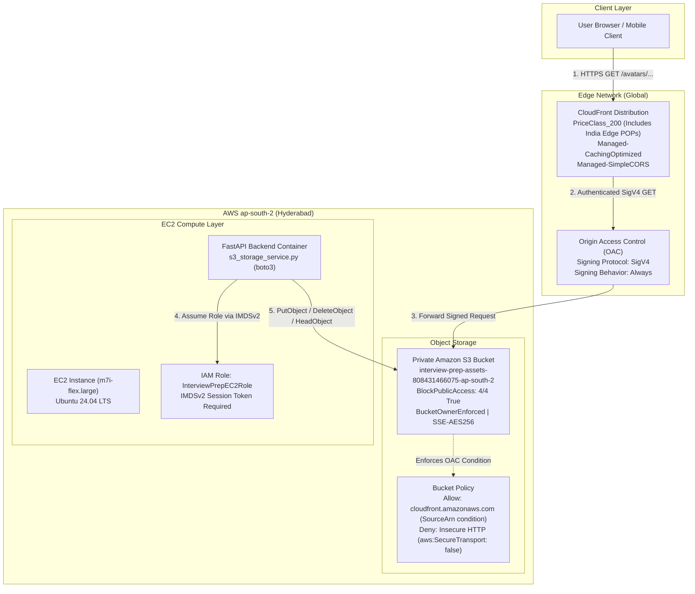

# AWS Infrastructure and IAM Specification: Cloudinary to S3 + CloudFront Migration

## 1. Executive Summary & Architecture

This document defines the production infrastructure, IAM security policies, deployment runbooks, validation gates, cost projections, and rollback procedures for migrating the Interview Prep asset delivery pipeline from Cloudinary to Amazon Simple Storage Service (Amazon S3) and Amazon CloudFront.

### Architecture Overview



### Key Design Principles

1. **Zero Public S3 Access**: The S3 bucket is completely private. Direct internet access is blocked via S3 Block Public Access (all 4 flags active). No object ACLs are permitted (`BucketOwnerEnforced`).
2. **Modern CloudFront Origin Access Control (OAC)**: Replaces legacy Origin Access Identity (OAI). OAC uses AWS Signature Version 4 (SigV4) to authenticate CloudFront requests to S3, fully supporting SSE-KMS, regional endpoints like `ap-south-2`, and AWS partition compliance.
3. **Regional Endpoint Precision**: CloudFront is configured with the regional bucket endpoint (`${BucketName}.s3.ap-south-2.amazonaws.com`) rather than the global S3 endpoint (`${BucketName}.s3.amazonaws.com`), eliminating HTTP 307 temporary redirects that break SigV4 signed requests.
4. **Least-Privilege EC2 Runtime**: The backend FastAPI application runs on EC2 using instance metadata service v2 (IMDSv2) and inherits the existing `InterviewPrepEC2Role`. S3 permissions are scoped strictly to the target bucket ARN and its objects.
5. **Infrastructure as Code (IaC)**: The entire deployment is captured in a declarative, idempotent AWS CloudFormation template located at `infrastructure/cloudformation/assets-s3-cloudfront.yaml`.

---

## 2. Target Environment & Resource Identifiers

| Parameter | Value | Description |
|---|---|---|
| **AWS Account ID** | `808431466075` | Target AWS production account |
| **AWS Region** | `ap-south-2` | Hyderabad, India (co-located with EC2 workload) |
| **Target S3 Bucket Name** | `interview-prep-assets-808431466075-ap-south-2` | Globally unique S3 bucket identifier |
| **Existing EC2 IAM Role** | `InterviewPrepEC2Role` | Host role attached to EC2 instance profile |
| **CloudFront Price Class** | `PriceClass_200` | Covers North America, Europe, Asia, Middle East, Africa (includes Indian Edge locations) |
| **CloudFront Cache Policy** | `658327ea-f89d-4fab-a63d-7e88639e58f6` | Managed-CachingOptimized |
| **CloudFront Response Headers** | `60669652-455b-4ae9-85a4-c4c02393f86c` | Managed-SimpleCORS |

### Object Key Namespace Schema

All assets uploaded to the S3 bucket follow the structured namespace contract:

* **User Profile Avatars**: `avatars/{user_id}/{unique_uuid}.{ext}`
* **System Design Diagrams & Lessons**: `system-design/{chapter_number}/{filename_slug}.{ext}`
* **Static Application Media**: `static/{category}/{filename_slug}.{ext}`

---

## 3. CloudFormation Template Architecture

The CloudFormation template is located at:
`infrastructure/cloudformation/assets-s3-cloudfront.yaml`

### Template Resource Matrix

#### 1. S3 Storage Bucket (`AssetsBucket`)
* **BucketName**: Parameterized, defaulting to `interview-prep-assets-808431466075-ap-south-2`.
* **PublicAccessBlockConfiguration**:
  * `BlockPublicAcls: true`
  * `IgnorePublicAcls: true`
  * `BlockPublicPolicy: true`
  * `RestrictPublicBuckets: true`
* **OwnershipControls**: `BucketOwnerEnforced` (disables all S3 ACLs; the AWS account owning the bucket owns all objects).
* **BucketEncryption**: Server-side encryption with AWS managed keys (`AES256`) and `BucketKeyEnabled: true` (reduces encryption overhead).
* **CorsConfiguration**: Allows `GET` and `HEAD` from `*` to ensure cross-origin avatar and diagram loading from browser frontends.
* **LifecycleConfiguration**: `AbortIncompleteMultipartUploads` enabled after 7 days to eliminate orphaned multipart storage costs.

#### 2. CloudFront Origin Access Control (`AssetsOriginAccessControl`)
* **Name**: `${AWS::StackName}-s3-oac`
* **OriginAccessControlOriginType**: `s3`
* **SigningBehavior**: `always`
* **SigningProtocol**: `sigv4`

#### 3. CloudFront Distribution (`AssetsDistribution`)
* **Origin**:
  * `DomainName`: `!GetAtt AssetsBucket.RegionalDomainName`
  * `OriginAccessControlId`: `!GetAtt AssetsOriginAccessControl.Id`
  * `S3OriginConfig: { OriginAccessIdentity: "" }`
* **DefaultCacheBehavior**:
  * `ViewerProtocolPolicy`: `redirect-to-https`
  * `AllowedMethods`: `[GET, HEAD]`
  * `CachedMethods`: `[GET, HEAD]`
  * `Compress`: `true` (enables Gzip and Brotli compression at edge)
  * `CachePolicyId`: `658327ea-f89d-4fab-a63d-7e88639e58f6` (`Managed-CachingOptimized`)
  * `ResponseHeadersPolicyId`: `60669652-455b-4ae9-85a4-c4c02393f86c` (`Managed-SimpleCORS`)
* **ViewerCertificate**: `CloudFrontDefaultCertificate: true` (AWS-managed wildcard certificate on `*.cloudfront.net`).
* **PriceClass**: `PriceClass_200` (can be overridden to `PriceClass_All` or `PriceClass_100`).

#### 4. S3 Bucket Policy (`AssetsBucketPolicy`)
Enforces two mandatory security statements:
1. `AllowCloudFrontServicePrincipalReadOnly`: Grants `s3:GetObject` strictly to principal `cloudfront.amazonaws.com` conditioned on `AWS:SourceArn` matching the specific CloudFront distribution ARN. This protects against the confused deputy vulnerability.
2. `EnforceTlsRequestsOnly`: Explicit `Deny` on `s3:*` when `aws:SecureTransport` is `false`, ensuring that all communications to S3 use TLS 1.2+.

#### 5. IAM Policy Attachment (`BackendEC2S3Policy`)
When parameter `AttachPolicyToRole` is `true`, attaches an inline policy directly to the existing `InterviewPrepEC2Role`, granting scoped object operations on the bucket.

### Template Outputs

* `BucketName`: Physical name of the S3 bucket.
* `BucketArn`: ARN of the S3 bucket (`arn:aws:s3:::interview-prep-assets-808431466075-ap-south-2`).
* `CloudFrontDistributionId`: CloudFront distribution ID (used for cache invalidations).
* `CloudFrontDomainName`: CloudFront FQDN (e.g., `d111111abcdef8.cloudfront.net`).
* `AssetBaseUrl`: HTTPS base delivery URL (`https://${CloudFrontDomainName}`).

---

## 4. EC2 Least-Privilege IAM Policy Specification

### Standalone IAM Policy JSON

If you prefer to attach the IAM policy manually via the AWS Console or AWS CLI (or if `AttachPolicyToRole` was set to `false`), use the following standalone policy:

```json
{
  "Version": "2012-10-17",
  "Statement": [
    {
      "Sid": "InterviewPrepScopedObjectOperations",
      "Effect": "Allow",
      "Action": [
        "s3:PutObject",
        "s3:GetObject",
        "s3:DeleteObject"
      ],
      "Resource": "arn:aws:s3:::interview-prep-assets-808431466075-ap-south-2/*"
    },
    {
      "Sid": "InterviewPrepScopedBucketListing",
      "Effect": "Allow",
      "Action": [
        "s3:ListBucket"
      ],
      "Resource": "arn:aws:s3:::interview-prep-assets-808431466075-ap-south-2"
    }
  ]
}
```

### Technical Note on `HeadObject` and IAM Permissions

> [!NOTE]
> In Amazon S3, **`s3:HeadObject` is an API operation, NOT an IAM action**.
> 
> * AWS IAM maps the `HeadObject` API call directly to the **`s3:GetObject`** permission. Specifying `"Action": ["s3:HeadObject"]` in an IAM policy is invalid and will trigger an `Unrecognized action` warning or policy validation error.
> * Granting `s3:GetObject` on `arn:aws:s3:::interview-prep-assets-808431466075-ap-south-2/*` fully authorizes boto3's `s3_client.head_object(Bucket=..., Key=...)` method.
> * Additionally, **`s3:ListBucket`** is included on the bucket resource. When a requested object does NOT exist in S3:
>   * With `s3:ListBucket`: S3 returns a standard `404 Not Found` error.
>   * Without `s3:ListBucket`: S3 returns an ambiguous `403 Forbidden` error to prevent leaking key existence. Providing `s3:ListBucket` allows application code to reliably detect missing objects.

### Manual Attachment via AWS CLI

To manually attach this policy to the existing `InterviewPrepEC2Role`:

```bash
aws iam put-role-policy \
  --role-name InterviewPrepEC2Role \
  --policy-name InterviewPrepS3AccessPolicy \
  --policy-document '{
    "Version": "2012-10-17",
    "Statement": [
      {
        "Sid": "InterviewPrepScopedObjectOperations",
        "Effect": "Allow",
        "Action": [
          "s3:PutObject",
          "s3:GetObject",
          "s3:DeleteObject"
        ],
        "Resource": "arn:aws:s3:::interview-prep-assets-808431466075-ap-south-2/*"
      },
      {
        "Sid": "InterviewPrepScopedBucketListing",
        "Effect": "Allow",
        "Action": [
          "s3:ListBucket"
        ],
        "Resource": "arn:aws:s3:::interview-prep-assets-808431466075-ap-south-2"
      }
    ]
  }'
```

---

## 5. Deployment Guide

### Prerequisites

1. AWS CLI v2 installed and configured.
2. Active credentials for AWS Account `808431466075` with permissions for CloudFormation, S3, CloudFront, and IAM.
3. Target deployment region set to `ap-south-2`.

```bash
export AWS_DEFAULT_REGION="ap-south-2"
export AWS_REGION="ap-south-2"
```

### Step 1: Validate CloudFormation Template

Perform static syntax and structural validation:

```bash
aws cloudformation validate-template \
  --template-body file://infrastructure/cloudformation/assets-s3-cloudfront.yaml \
  --region ap-south-2
```

### Step 2: Create and Review Change Set (Recommended for Production)

Before applying changes, generate an inspection change set:

```bash
aws cloudformation create-change-set \
  --stack-name interview-prep-assets-stack \
  --change-set-name migration-initial-setup \
  --template-body file://infrastructure/cloudformation/assets-s3-cloudfront.yaml \
  --parameters \
      ParameterKey=Environment,ParameterValue=production \
      ParameterKey=BucketName,ParameterValue=interview-prep-assets-808431466075-ap-south-2 \
      ParameterKey=EC2RoleName,ParameterValue=InterviewPrepEC2Role \
      ParameterKey=AttachPolicyToRole,ParameterValue=true \
      ParameterKey=PriceClass,ParameterValue=PriceClass_200 \
  --capabilities CAPABILITY_IAM \
  --region ap-south-2
```

Inspect the pending changes:

```bash
aws cloudformation describe-change-set \
  --stack-name interview-prep-assets-stack \
  --change-set-name migration-initial-setup \
  --region ap-south-2
```

### Step 3: Execute CloudFormation Deployment

Deploy the stack (either via change set execution or direct deploy):

```bash
aws cloudformation deploy \
  --stack-name interview-prep-assets-stack \
  --template-file infrastructure/cloudformation/assets-s3-cloudfront.yaml \
  --parameter-overrides \
      Environment=production \
      BucketName=interview-prep-assets-808431466075-ap-south-2 \
      EC2RoleName=InterviewPrepEC2Role \
      AttachPolicyToRole=true \
      PriceClass=PriceClass_200 \
  --capabilities CAPABILITY_IAM \
  --region ap-south-2 \
  --no-fail-on-empty-changeset
```

> [!NOTE]
> CloudFront distribution creation typically takes between 3 to 5 minutes to globally propagate edge configurations.

### Step 4: Extract Stack Outputs

Retrieve the deployed endpoints and bucket parameters:

```bash
aws cloudformation describe-stacks \
  --stack-name interview-prep-assets-stack \
  --region ap-south-2 \
  --query "Stacks[0].Outputs" \
  --output table
```

Or query individual output values directly into environment variables:

```bash
export S3_ASSETS_BUCKET=$(aws cloudformation describe-stacks \
  --stack-name interview-prep-assets-stack \
  --region ap-south-2 \
  --query "Stacks[0].Outputs[?OutputKey=='BucketName'].OutputValue" \
  --output text)

export ASSET_BASE_URL=$(aws cloudformation describe-stacks \
  --stack-name interview-prep-assets-stack \
  --region ap-south-2 \
  --query "Stacks[0].Outputs[?OutputKey=='AssetBaseUrl'].OutputValue" \
  --output text)

export CF_DISTRIBUTION_ID=$(aws cloudformation describe-stacks \
  --stack-name interview-prep-assets-stack \
  --region ap-south-2 \
  --query "Stacks[0].Outputs[?OutputKey=='CloudFrontDistributionId'].OutputValue" \
  --output text)

echo "S3 Bucket:         $S3_ASSETS_BUCKET"
echo "Asset Base URL:    $ASSET_BASE_URL"
echo "Distribution ID:   $CF_DISTRIBUTION_ID"
```

### Step 5: Update Application Environment Variables

Update the backend `.env` file on the EC2 host:

```bash
# Add to backend .env / docker environment
S3_ASSETS_BUCKET=interview-prep-assets-808431466075-ap-south-2
S3_ASSETS_REGION=ap-south-2
ASSET_BASE_URL=https://<your-distribution-id>.cloudfront.net
```

---

## 6. Verification and Validation Runbook

Follow this 5-gate testing procedure to verify operational security and functional readiness before migrating traffic.

### Gate 1: S3 Public Access Block Verification

Verify that all 4 public access block parameters are strictly enforced:

```bash
aws s3api get-public-access-block \
  --bucket interview-prep-assets-808431466075-ap-south-2 \
  --region ap-south-2
```

**Expected Result:**
```json
{
  "PublicAccessBlockConfiguration": {
    "BlockPublicAcls": true,
    "IgnorePublicAcls": true,
    "BlockPublicPolicy": true,
    "RestrictPublicBuckets": true
  }
}
```

### Gate 2: Direct S3 Direct Public Access Denial

Verify that direct HTTP requests to the S3 bucket endpoint are denied by S3:

```bash
curl -s -o /dev/null -w "%{http_code}\n" \
  https://interview-prep-assets-808431466075-ap-south-2.s3.ap-south-2.amazonaws.com/test-probe.txt
```

**Expected Result:**
`403` (Access Denied).

### Gate 3: EC2 IAM Role Runtime Verification

From the EC2 host (connected via AWS Systems Manager Session Manager), test upload and metadata retrieval:

```bash
# Connect to EC2 instance via SSM
aws ssm start-session --target <instance-id> --region ap-south-2

# Inside the EC2 instance, execute the verification script
python3 -c "
import boto3

s3 = boto3.client('s3', region_name='ap-south-2')
bucket = 'interview-prep-assets-808431466075-ap-south-2'
key = 'static/test/probe.txt'

# 1. Put Object
s3.put_object(Bucket=bucket, Key=key, Body=b'Infrastructure verification test payload', ContentType='text/plain')
print('Upload: SUCCESS')

# 2. Head Object (Authorized via s3:GetObject)
meta = s3.head_object(Bucket=bucket, Key=key)
print('HeadObject: SUCCESS (ContentLength:', meta['ContentLength'], ')')

# 3. List Objects
listing = s3.list_objects_v2(Bucket=bucket, Prefix='static/test/')
print('ListObjects: SUCCESS (Found keys:', [obj['Key'] for obj in listing.get('Contents', [])], ')')
"
```

**Expected Result:**
All three operations report `SUCCESS`.

### Gate 4: CloudFront Edge Delivery and Cache Verification

Verify that the uploaded test asset is served through CloudFront with appropriate headers:

```bash
# First request (Origin Fetch / Cache Miss)
curl -I "${ASSET_BASE_URL}/static/test/probe.txt"
```

**Expected Headers:**
* `HTTP/2 200`
* `x-cache: Miss from cloudfront`
* `server: CloudFront`

Now execute a second request immediately:

```bash
# Second request (Edge Cache Hit)
curl -I "${ASSET_BASE_URL}/static/test/probe.txt"
```

**Expected Headers:**
* `HTTP/2 200`
* `x-cache: Hit from cloudfront` (or `RefreshHit from cloudfront`)

### Gate 5: Cross-Origin Resource Sharing (CORS) Verification

Verify that CloudFront includes valid CORS response headers when requested with an `Origin` header:

```bash
curl -I -H "Origin: https://interviewprep.example.com" \
  "${ASSET_BASE_URL}/static/test/probe.txt"
```

**Expected Headers:**
* `access-control-allow-origin: *`
* `access-control-allow-methods: GET, HEAD`

---

## 7. Cost Considerations & Billable Resources

### Cost Comparison: S3 + CloudFront vs. Cloudinary

| Dimension | Cloudinary (Current) | AWS S3 + CloudFront (Target) |
|---|---|---|
| **Free Tier Allowance** | 25 Credits/month (~25,000 transformations or 25 GB net bandwidth) | **1 TB Data Transfer Out/month** (CloudFront Free Tier forever) + **10,000,000 HTTP/S requests/month** |
| **Paid Tier Floor** | $89.00/month (Plus plan minimum upon limit breach) | **Pay-as-you-go** (no monthly baseline subscription) |
| **Storage Cost** | High cost per extra GB credit | **$0.023 per GB/month** (S3 Standard in `ap-south-2`) |
| **Data Transfer Between S3 and CloudFront** | N/A | **$0.00 (Free)** (AWS does not charge for egress from S3 to CloudFront) |
| **CDN Request Cost** | Bundled in credits | **$0.0075 per 10,000 HTTPS requests** (beyond the 10M free tier) |
| **Projected Monthly Bill** | ~$0 (Free Tier) to $89+ (Risk of sudden overage) | **<$1.00 to $3.00/month** under normal traffic growth |

### Billable Component Breakdown

1. **Amazon S3 Storage**:
   * S3 Standard Storage (`ap-south-2`): $0.023 / GB / month.
   * For 10 GB of avatars and lesson media: **~$0.23 / month**.
2. **Amazon S3 Requests**:
   * PUT / POST operations: $0.005 per 1,000 requests.
   * GET / HEAD operations (origin fetches): $0.0004 per 1,000 requests.
   * With CloudFront's `CachingOptimized` policy (24-hour default TTL), origin GET requests are minimized by over 95%.
3. **Amazon CloudFront Egress & Edge Requests**:
   * 1 TB Data Transfer Out: $0.00 (within AWS Free Tier).
   * 10M HTTPS requests: $0.00 (within AWS Free Tier).
4. **AWS Origin Access Control (OAC)**:
   * **$0.00** (OAC is an AWS platform feature with no additional surcharge).

---

## 8. Rollback, Disaster Recovery & Cleanup Runbook

### Scenario A: Rollback During Pre-Cutover Testing

If deployment testing fails and the stack needs to be completely removed before production traffic is pointed to CloudFront:

1. **Empty the S3 Bucket**: S3 buckets containing objects cannot be deleted by CloudFormation. Empty the bucket first:
   ```bash
   aws s3 rm "s3://interview-prep-assets-808431466075-ap-south-2" --recursive --region ap-south-2
   ```

2. **Delete the CloudFormation Stack**:
   ```bash
   aws cloudformation delete-stack \
     --stack-name interview-prep-assets-stack \
     --region ap-south-2
   ```

3. **Monitor Stack Deletion**:
   ```bash
   aws cloudformation wait stack-delete-complete \
     --stack-name interview-prep-assets-stack \
     --region ap-south-2
   ```

### Scenario B: Emergency Rollback During Live Production

If an operational incident occurs after switching traffic to CloudFront:

1. **Revert Application Configuration**:
   Update backend `.env` to restore Cloudinary fallback parameters:
   ```bash
   # In backend/.env
   STORAGE_PROVIDER=cloudinary
   ```
2. **Restart Backend Service**:
   ```bash
   docker compose restart backend
   ```
   Because existing Cloudinary URLs in the database or legacy assets remain intact during the migration phases, reverting the environment variable immediately routes new uploads back to Cloudinary with zero downtime.

3. **Purge CloudFront Edge Cache (If Stale/Corrupted Content Exists)**:
   If a corrupted asset was cached at CloudFront edge POPs, trigger an edge cache invalidation:
   ```bash
   aws cloudfront create-invalidation \
     --distribution-id "${CF_DISTRIBUTION_ID}" \
     --paths "/*"
   ```

### Scenario C: Clean Teardown / Decommissioning

If the application is permanently decommissioned or migrated to another account:

```bash
# 1. Empty all bucket objects and versions
aws s3 rm "s3://interview-prep-assets-808431466075-ap-south-2" --recursive --region ap-south-2

# 2. Delete the CloudFormation stack
aws cloudformation delete-stack \
  --stack-name interview-prep-assets-stack \
  --region ap-south-2

# 3. If IAM policy was manually attached to InterviewPrepEC2Role, detach it
aws iam delete-role-policy \
  --role-name InterviewPrepEC2Role \
  --policy-name InterviewPrepS3AccessPolicy
```
